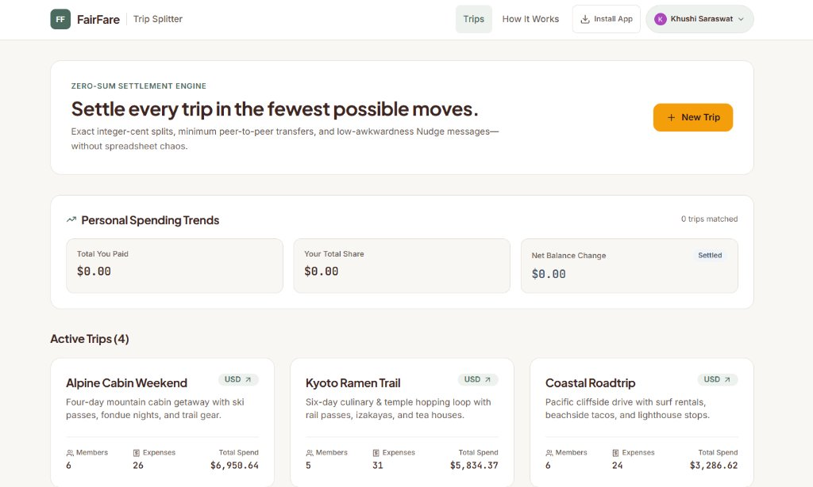
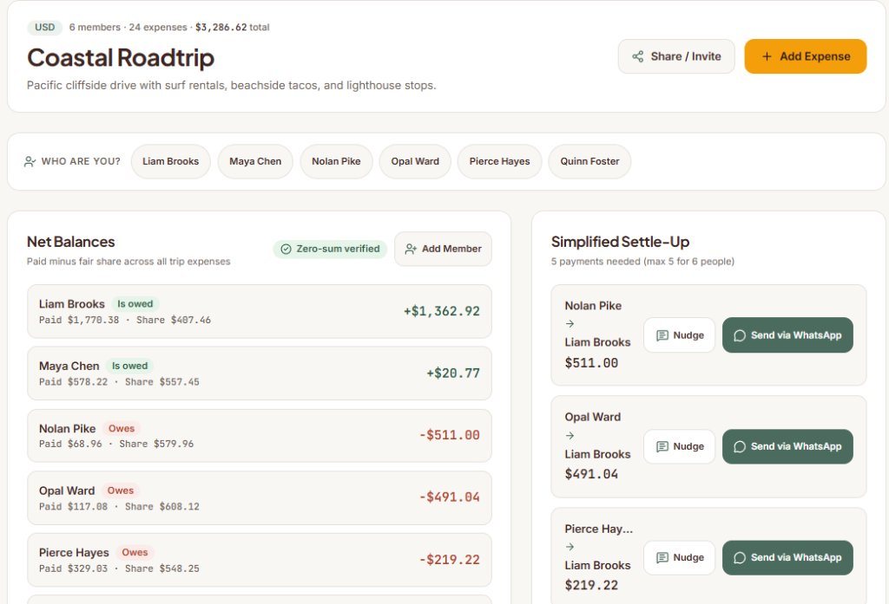
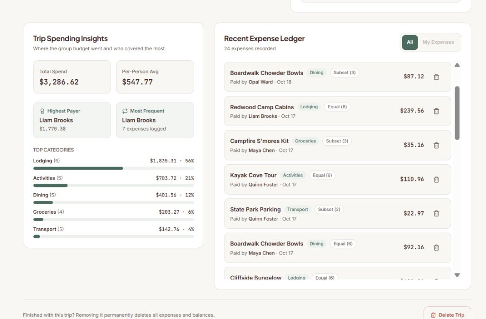

# FairFare – Trip Splitter

> **End the post-trip "who owes whom" fight with the absolute fewest possible peer-to-peer payments and zero social awkwardness.**

FairFare is a full-stack group expense settlement engine with a Minimalist Bento UI built on **FastAPI**, **SQLite / SQLAlchemy**, **Next.js 16 (App Router)**, **TypeScript**, and **Tailwind CSS 4**.

---

## Screenshots

### Dashboard — Active Trips & Personal Spending Trends


### Trip Detail — Net Balances, Simplified Settle-Up & WhatsApp Nudges


### Trip Insights & Expense Ledger


---

## Features

### 💰 Zero-Sum Settlement Engine
- All currency math uses **integer cents** (`int`) — no floating-point drift, ever.
- `sum(net_balances) == 0` is asserted on every calculation.
- **Greedy minimum-payment simplifier** reduces group debts to at most **N − 1** peer-to-peer transfers for N participants.

### ✂️ 3 Flexible Split Modes
| Mode | How it works |
|---|---|
| **Equal** | Splits evenly across all members; leftover cents distributed deterministically |
| **Select People** | Splits only among chosen participants (e.g. drinks for 3 of 6) |
| **Custom** | Exact unequal cent amounts with live remaining-cents validation |

### 📊 Personal Spending Trends
- Dashboard Bento card shows **Total You Paid**, **Your Total Share**, and **Net Balance Change** across all trips.
- Semantic `+` / `−` badges with `tabular-nums` display.

### 📋 Trip Spending Insights
- Total spend and per-person average.
- **Top spending categories** with percentage bars (Lodging, Activities, Dining, Groceries, Transport).
- **Highest Payer** and **Most Frequent Payer** surfaced automatically.

### 🔔 Low-Awkwardness Nudge Generator
- One-click copyable reminder messages in **Casual**, **Playful**, and **Direct** tones.
- **Send via WhatsApp** button pre-fills `wa.me/?text=...` with the debtor's amount, recipient name, and trip link — zero typing needed.

### 👤 Zero-Friction Identity (No Password Wall)
- **"Who are you?"** member pill bar on every trip page — tap your name once, saved in `localStorage`.
- Auto-preselects you as **"Paid by"** in `+ Add Expense` for the entire session.
- **Guest Profile pill** in the navbar stores your Display Name and optional UPI ID across trips.
- Full **Google OAuth + Email/Password + Guest Mode** auth via NextAuth.js.

### 📲 Share & Invite
- **Copy Trip Link** and **Invite via WhatsApp** buttons in every trip header.
- Share a pre-filled invite message with the trip name and URL in one tap.

### 🗂️ Trip Templates & Multi-Currency
- Quick-start templates: **Roadtrip 🚗**, **Flatmates 🏠**, **Event 🎉**, **Custom**.
- One-click currency switcher: **USD**, **INR**, **EUR**, **GBP**.

### 📱 Installable PWA
- `manifest.ts` configured for **Android & iOS home screen installation** (`standalone` display, Sage Green theme).
- Service worker caches the static shell for offline resilience.
- Dismissible **"Install App"** banner on mobile + native `beforeinstallprompt` trigger in the navbar.

### 🗑️ Full Trip Lifecycle
- Create, view, add expenses, settle up, and **Delete Trip** (with accessible confirmation modal).
- Cascading SQLite delete across `Trip → Member → Expense → ExpenseSplit`.

### 🔍 My Expenses Filter
- Toggle between **All** and **My Expenses** in the Expense Ledger to instantly filter by payer or split participant.

### 5 Pre-Seeded Synthetic Trips
Deterministically seeded on startup with zero real PII:

| Trip | Members | Expenses | Total Spend |
|---|---|---|---|
| Alpine Cabin Weekend | 6 | 26 | ~\$6,950 |
| Kyoto Ramen Trail | 5 | 31 | ~\$5,834 |
| Coastal Roadtrip | 6 | 24 | ~\$3,286 |
| Desert Music Fest | 5 | 35 | ~\$4,100 |
| Lakehouse Retreat | 6 | 28 | ~\$3,900 |

---

## Tech Stack

| Layer | Technology |
|:---|:---|
| **Frontend** | Next.js 16 (App Router), React 19, TypeScript, Tailwind CSS 4 |
| **Auth** | NextAuth.js v4 — Google OAuth + Email/Password + Guest Mode |
| **Backend** | FastAPI (Python 3.11+), Pydantic v2, Uvicorn |
| **Database** | SQLite + SQLAlchemy 2.0 (`PRAGMA foreign_keys=ON`) |
| **PWA** | Web App Manifest + Service Worker |
| **Design System** | Minimalist Bento UI · 60/30/10 Warm Alabaster / Sage Green / Amber Glow · WCAG 2.2 AA |

---

## Project Structure

```text
.
├── backend/
│   ├── app/
│   │   ├── main.py               # FastAPI entrypoint, CORS, lifespan seeder
│   │   ├── database.py           # SQLite engine & session management
│   │   ├── models.py             # Trip, Member, Expense, ExpenseSplit, User ORM models
│   │   ├── schemas.py            # Contract-first Pydantic v2 schemas
│   │   ├── seed.py               # Deterministic 5-trip synthetic seeder
│   │   ├── routers/
│   │   │   ├── trips.py          # REST API endpoints (/api/trips/...)
│   │   │   └── users.py          # User sync, member claim, /me/summary
│   │   └── services/
│   │       ├── splitter.py       # Remainder-safe equal/subset/custom splitter
│   │       ├── settlement.py     # Zero-sum balance & greedy ≤ N-1 simplifier
│   │       ├── insights.py       # Category & payer analytics
│   │       └── nudge.py          # Casual / Playful / Direct message generator
│   ├── tests/
│   │   ├── test_settlement.py    # Core splitting & settlement unit tests
│   │   ├── test_api.py           # Integration & 90-minute gate tests
│   │   ├── test_phase4_qa.py     # Edge-case boundary math QA
│   │   └── run_all_tests.py      # Single-command test runner (21 tests)
│   └── requirements.txt
├── frontend/
│   ├── public/sw.js              # Service worker for PWA offline caching
│   └── src/
│       ├── app/                  # App Router pages (/, /trips/[id], /how-it-works, /privacy, /terms)
│       │   ├── manifest.ts       # PWA Web App Manifest
│       │   └── api/auth/         # NextAuth.js route handler
│       ├── components/           # Bento cards, Navbar, Modals, PwaManager, PersonalTrendsCard
│       ├── lib/                  # Typed API client & integer-cent formatters
│       └── types/                # TypeScript contracts mirroring Pydantic schemas
└── docs/                         # PRD, architecture, design system, rules, roadmap, pitch, screenshots
```

---

## Getting Started

### 1. Backend (FastAPI)

```bash
cd backend
pip install -r requirements.txt
python -m uvicorn app.main:app --reload --port 8000
```

- Swagger Docs: `http://localhost:8000/docs`
- Health Check: `http://localhost:8000/health`

### 2. Frontend (Next.js)

Create `frontend/.env.local`:

```env
NEXT_PUBLIC_API_URL=http://127.0.0.1:8000
NEXTAUTH_SECRET=<any-32-char-random-string>
NEXTAUTH_URL=http://localhost:3000

# Optional — only needed for Google Sign-In
GOOGLE_CLIENT_ID=<your-google-client-id>
GOOGLE_CLIENT_SECRET=<your-google-client-secret>
```

Then run:

```bash
cd frontend
npm install
npm run dev
```

Open `http://localhost:3000`.

---

## Running Tests & Production Build

### Backend (21 tests)

```bash
cd backend
python tests/run_all_tests.py
```

### Frontend

```bash
cd frontend
npm run lint        # 0 errors
npx tsc --noEmit    # 0 type errors
npm run build       # 10 routes, clean build
```

---

## Design System

FairFare uses a **60/30/10 colour palette** with strict WCAG 2.2 AA contrast ratios:

| Role | Colour | Hex |
|---|---|---|
| Background (60%) | Warm Alabaster | `#F8F7F4` |
| Surface | Crisp Parchment | `#FFFFFF` |
| Muted Tint | Muted Sage Tint | `#EEF2EE` |
| Primary (30%) | Sage Green | `#4A6B5D` |
| Text | Deep Walnut | `#3E2723` |
| Secondary Text | Warm Taupe | `#6D5D56` |
| Accent (10%) | Amber Glow | `#F59E0B` |
| Danger | Terracotta Rust | `#B84A39` |

All skeleton loaders pulse in `#EEF2EE`. All touch targets are ≥ `44 × 44 px`. Currency figures use `tabular-nums`.
